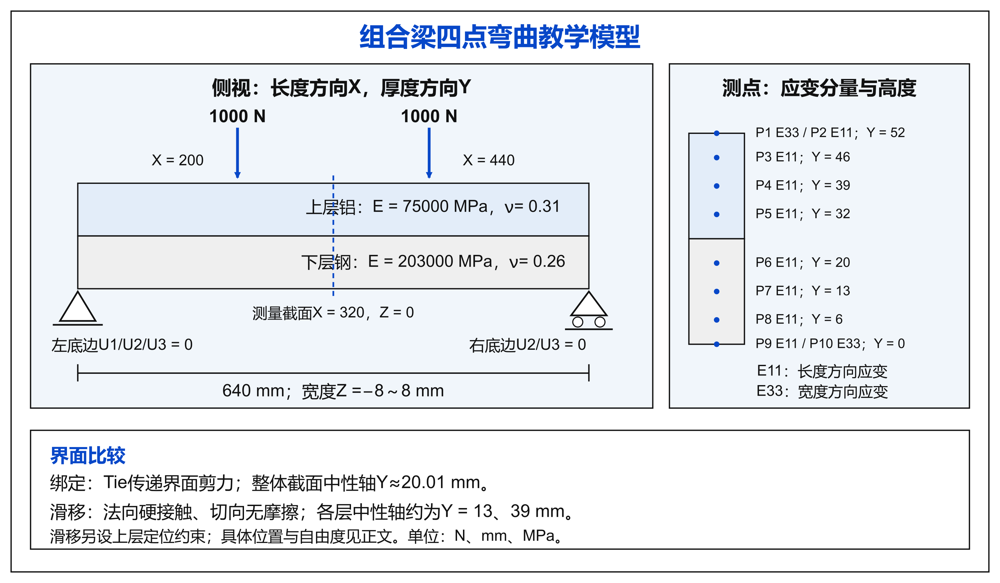
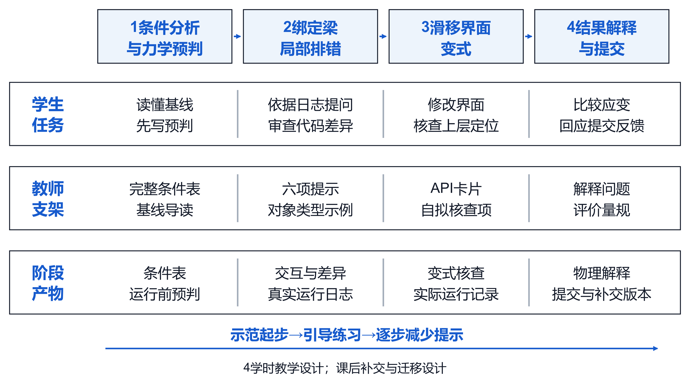
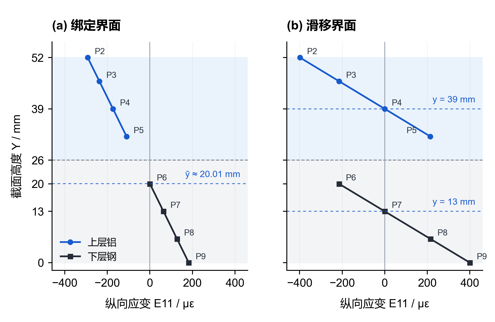

# AI辅助Abaqus仿真教程

AI2abaqus配套教程 v1.0

适用对象：材料力学已学、Abaqus初学的本科生。学习安排：4学时（每学时45 min）＋课后提交。操作入口：教师预配置、能加载AI2abaqus并调用工具的AI助手。配套技能版本：0.1.0；配套论文：v3.0。

你将从可读基线出发，完成绑定梁排错和滑移界面变式，说明修改依据并核验结果。本教程是教学资源，已有案例和模拟提交用于示范；尚未开展真实学生课堂效果评价。示例输入可以帮助起步，你需要用自己的实际条件、日志和判断替换其中的说明。

## 1 开始前先确认什么

|项目|你应确认的状态|
|---|---|
|技能入口|助手能识别$ai2abaqus，能说明当前技能版本与任务范围|
|执行位置|助手能报告教师指定的授权虚拟机及本次工作目录；本项目计算在3090 Windows虚拟机|
|模型服务|代码帮助和评价使用qwen3.7-plus，真实回复和调用摘要可留存|
|软件条件|教师已检查Abaqus启动器、软件版本及许可连接|
|个人任务|本次练习使用独立目录和实际操作者身份，保留已有文件与失败记录|

若助手找不到技能、模型服务或软件许可，请先向教师反馈当前状态。环境准备完成后再开始软件练习。教程使用自然语言指挥助手；命令和文件结构放在教师附录，供检查实现时使用。

~~~text
先读取配套教程 v1.0，再使用 $ai2abaqus 开始本次组合梁练习。先告诉我技能版本、授权执行位置、软件环境和任务范围。请先读取任务条件，引导我写力学预判；在我说明修改的采纳理由后再执行，并保留真实交互、差异、运行和核验记录。代码帮助与评价使用教师已配置的 qwen3.7-plus。
~~~

## 2 认识本次组合梁任务

单位制为N、mm、MPa。X是长度方向，Y是厚度方向，Z是宽度方向。梁长640 mm、宽16 mm（Z=−8～8），下层Y=0～26为钢，E=203000 MPa、ν=0.26；上层Y=26～52为铝，E=75000 MPa、ν=0.31。上表面X=200、440 mm处各施加1000 N向下载荷，总载荷2000 N。下层左底边约束U1/U2/U3，右底边约束U2/U3并释放U1。

图1 组合梁任务条件与测点

任务一采用Tie绑定。任务二采用小滑移面面接触，法向硬接触、直接约束、允许分离，切向无摩擦；上层(0,26,0)约束U1/U3，(640,26,0)约束U3。两例均为小变形线弹性静力，无人工稳定化，每层512个C3D20R单元。请先说明每项条件的物理含义，再请助手核对实际实现。

10项输出均在X=320、Z=0取得。P2—P9为E11，上层Y=52、46、39、32，下层Y=20、13、6、0；P1和P10分别为最上、最下表面的E33。取末帧、同一实例相邻单元ELEMENT_NODAL贡献的算术平均。界面法向为Y，核查法向应力对应S22；E33是宽度应变。

## 3 第1学时 条件分析、预判与基线导读

学习目标：能够用自己的语言说明模型条件，指出主要代码对象，并在查看结果前写出应变趋势。阶段产物：任务条件表和运行前预判。

图2 四学时学习任务与教师支架安排

### 3.1 初始化练习并核对条件

~~~text
请在教师授权虚拟机的新目录初始化绑定梁Region练习，保持题目给定条件。先列出case与spec中的单位、尺寸、材料、支承、载荷、界面和输出，我会逐项核对。不要覆盖已有练习；暂不运行，也不先展示结果数值。
~~~

核对后，在任务分析文件中写明条件、来源与待确认问题。若题目与配置不一致，先请教师明确任务版本，不能在同一会话静默改成另一项任务。真实学生练习使用student标识，教师演示使用developer-demo；课堂前由教师设置，避免把示范材料登记成学生数据。

### 3.2 先写力学预判

根据材料刚度、截面位置和界面条件，写出绑定梁整体中性轴的计算式，预测上层、下层主要测点的应变符号。对滑移理想化，说明无剪切传递并保持接触时各层中性轴如何变化。先完成这段说明，再请求查看计算结果。

~~~text
我的运行前预判是：【写入自己的计算与理由】。请将其以实际作者身份保存为预判记录。若其中有不清楚的假设，请提出需要我澄清的问题；后续解释修正另存，不改写最初预判。
~~~

### 3.3 读懂基线的主要对象

~~~text
请带我阅读基线中几何、材料、网格、支承、界面、载荷和输出七个部分。每部分指出对应对象和关键代码，只解释当前任务需要理解的内容。请让我回答设置依据，再进入下一部分。
~~~

自检：p、m、a分别在当前代码中代表什么？Part中的集合与Assembly中的集合如何参与赋值？载荷总量如何分配到节点？你应能指认代码位置并说明其物理依据。遇到不熟悉的API可请助手解释，但应回到具体对象和题目条件核对。

## 4 第2学时 绑定梁局部排错

学习目标：能依据真实日志提出受限问题，审查修改并解释后续错误。阶段产物：原始日志、提问、真实回复、代码差异和采纳理由。教师明确在练习源稿中设置了Region类型故障，该故障不是AI自然生成结果。

### 4.1 运行并识别第一处阻断

~~~text
这是教师设置的Region故障演示。我已核对任务条件与预判，请记录对当前源码的审查范围并在授权虚拟机实际运行。失败后保存原始日志，指出出错行、对象类型和软件终态；先区分环境故障与脚本故障。
~~~

若日志为CellArray与Region不匹配，定位SectionAssignment的region参数。若实际出现许可连接失败，则尚未进入这段建模代码，应先处理环境，不把该终态解释为Region故障。

### 4.2 使用六项上下文提问

~~~text
任务背景：组合梁四点弯曲，材料力学已学、Abaqus初学。
已知条件：p是Part，p.cells为CellArray。
修改范围：只修正p.SectionAssignment(region=p.cells,sectionName=key)所在行，保留循环缩进。
真实报错：【粘贴本次实际日志与出错行】。
保护条件：材料、几何、载荷、支承、界面和测点不变。
交付与验收：返回精确旧片段、新代码、修改理由和三项待核查问题；如使用Set，解释其完整创建方式。
~~~

### 4.3 审查差异后运行

逐项核查：修改是否只作用于指定行？返回对象是否适合作为Region？Set是否有合法名称？所在Part和材料是否保持？缩进与语法是否正确？已验证的具名集合形式为p.Set(name='SOLID',cells=p.cells)，但仍需结合所在对象与上下文审查。

~~~text
我采纳本次修改，理由是：【填写对象、接口和物理条件的核查结果】。请保存模型建议与我的审查理由，确认源码版本相符后应用并实际运行。若需要教师修正，请单独标明作者、位置和理由。
~~~

已知演示中，AI两次提出p.Set(cells=p.cells)而遗漏name，实际执行继续失败；开发者模拟教师补充name后通过。请根据自己的真实运行记录分析，不能将这段历史演示复制为个人经历。自检：第一条报错消失为何还需检查终态？下一次求助应增加什么证据？

## 5 第3学时 滑移界面变式

学习目标：能够把物理界面变化转化为局部修改，并发现接口之外的条件遗漏。阶段产物：变式条件、审查清单、差异和实际终态。由教师提供已验证的绑定基线，初始化新的sliding/interface会话；它以绑定源码为起点，以滑移条件为目标。

### 5.1 先写改变项和保留项

~~~text
请在新的滑移界面练习目录使用已验证绑定基线。目标是规定的无摩擦滑移任务。先让我写改变项、保留项及力学预判；随后只提出界面代码和必要上层定位的局部修改，保护几何、材料、下层支承、载荷、网格与输出。
~~~

改变项包括Tie向规定接触的替换及必要上层定位。保留项来自完整任务条件。请在看到AI代码前，自行列出接触面、法向、切向、刚体自由度和残留Tie的核查项。

### 5.2 用API卡片辅助审查

教师卡片：cp=m.ContactProperty('INTER_PROP')返回接触属性对象；cp.NormalBehavior使用HARD、allowSeparation=ON、constraintEnforcementMethod=DIRECT；cp.TangentialBehavior使用FRICTIONLESS。m.SurfaceToSurfaceContactStd使用既有bottom/top表面，Initial步、SMALL、SURFACE_TO_SURFACE、adjustMethod=NONE。本示范实际使用Abaqus 2026的main/secondary参数。

接口名称应与当前版本和对象核对。上层(0,26,0)约束U1/U3，(640,26,0)约束U3，均不额外限制其竖向位移。请说明这些条件各消除什么自由度。已知演示中AI曾误用contactProperties属性，后续仍遗漏定位，教师支架和修正均有单独记录。

### 5.3 执行并核对实际模型

~~~text
我已完成界面与定位审查：【写入理由和仍需教师核查处】。请保存差异和审查记录，在授权虚拟机执行。成功后从实际INP检查接触属性、接触对、支承、载荷与残留Tie，并独立读取ODB核对结果。请将设置错误与求解器终态分别报告。
~~~

自检：源码出现接触命令是否足够？用Tie完成滑移任务即使有ODB，为何仍不满足题目？若模型因刚体运动失败，应该先检查哪些条件？请引用实际文件位置说明。

## 6 第4学时 结果解释与独立核查

学习目标：能够将设置、取数与物理解释连起来。阶段产物：测点结果、平衡检查、理论比较和偏差解释。先读原预判，再查看独立核验报告。

~~~text
请对本次实际成功的run进行完整核验，报告设置检查、独立ODB与CSV一致性、参考比较、合力与力矩平衡、CAE重开和清洁复跑的实际结果。请使用真实成功run编号，不把文件存在或退出码单独当作通过。
~~~

依次回答：实际界面与题目一致吗？测点的实例、坐标、方向和平均方式正确吗？力与力矩平衡吗？纵向应变符号和中性轴与预判有何联系？哪些差异可能来自三维效应、接触和取数方式？引用自己的结果，不只复述助手结论。

|层次|检查内容|你需要给出的解释|
|---|---|---|
|设置|实际INP的材料、单元、支承、载荷、界面|它们如何对应题目条件|
|数据|独立ODB与CSV、同条件数值参考、整体平衡|取了什么、怎样平均、为何比较|
|复现|保存CAE重开、执行时源码清洁复跑|保存模型与源码各证明什么|

参考应变容差为max(5%参考绝对值，2 με)，整体合力和力矩相对残差不超过1%。CSV与独立ODB取值使用更严格一致性阈值。该参考采用同条件软件设定，只支持实现校核。修改几何、材料或载荷后，应重新建立任务与验收配置。

### 6.1 已知示范结果与解释练习

图3 既有真实案例的纵向应变分布

本图为此前经人工支架与修正后通过核验的示范结果。绑定整体中性轴约Y=20.01 mm；滑移理想化中性轴约Y=13、39 mm。请解释P5与P6为何在两种界面下符号不同，并区分“与理论趋势一致”“与数值参考一致”和“与物理实验一致”三种证据的含义。图中只含E11，E33另列于补充数据。

## 7 提交作业与回应反馈

提交五类过程材料及对应实际计算文件。将记录放在本次会话内部，保持可追溯的相对路径；文件名可参考下表。每次改动保留旧版本，说明AI、本人和教师各自做了什么。

|材料|建议文件|应包含的内容|
|---|---|---|
|任务分析|process/task_analysis.md|条件、来源、预判、适用假设|
|AI交互与审查|process/ai_review.md|真实提问与回复位置、差异、取舍理由|
|运行迭代|process/iteration.md|run编号、失败原因、修正与终态|
|力学校核|process/physics.md|设置、取数、平衡、理论与偏差解释|
|反思复现|process/reflection.md|贡献归属、适用范围、复跑与补交回应|
|实际工件|source/、runs/、verification/|源码、CAE、INP、ODB、CSV及原始日志|

~~~text
请根据我实际保存的五类过程文件收集提交证据，告诉我提交版本和证据编号；将技术验收状态与过程证据完整性分别说明。使用qwen3.7-plus按五维量规生成建议、引用和补交行动。缺少证据时列出缺项，教师最终评分保持待复核。
~~~

阅读反馈时，对照其引用文件判断理由是否有依据。若提出补交，逐项写出回应、增加或修改的文件及版本；若修改了源码或任务条件，先重新运行与核验，再收集新提交。补交后保留原报告，以新证据重新生成反馈。

~~~text
我对原提交【版本号】的回应如下：【逐项说明新增或修改内容及路径】。请建立关联的新提交版本，保留原报告。若实际文件已改变，请先核对是否需要重新求解与核验；新反馈只引用新提交的有效证据。
~~~

评价权重为：任务理解20、AI审查20、运行迭代25、结果与力学校核25、反思复现10。AI建议分供教师参考。材料更完整可以改变反馈，但是否体现理解，需要教师结合原始记录与现场解释判断。

## 8 独立练习与迁移设计

独立练习：选择已验证的绑定或滑移任务，减少示例提示后重新组织条件、预判、提问和检查项，复现并解释结果。教师可要求你现场说明一处AI建议的取舍、一处失败日志和一个关键测点。该练习不改变内置任务的物理条件。

迁移设计：为另一项弯曲任务写出单位、材料、支承、载荷、界面、输出和验收方案，标明哪些既有资源可复用、哪些需要新基线或新参考。先提交设计供教师复核，再在新的已验证配置下计算。当前技能验收器覆盖的仍是规定的两项组合梁任务。

## 9 常见问题与处理

|观察到的状态|先核查什么|下一步|
|---|---|---|
|许可或启动失败|软件是否真正进入建模、许可连接与执行位置|报告环境阻断，请教师恢复条件后有依据地续做|
|CellArray与Region不匹配|参数要求、所在Part、完整具名Set|局部修改、记录理由并实际运行|
|Model没有某属性|对象层级、版本API、真实出错行|结合API卡片追问，保留保护条件|
|有ODB但任务核验失败|实际界面、定位、载荷、支承与测点|定位物理差异，修订后重新验证|
|CSV与ODB不同|实例、帧、分量、坐标、平均方式|核对提取方法与原始结果|
|反馈被拒收|证据是否过期、编号存在、分值是否合法|保留原回复，以当前有效证据修正|

## 附录A 教师准备与工具对照

教师应先确认助手能读取本地技能入口、访问预配置qwen服务、操作授权虚拟机和实际文件。技能仓库不包含账号、模型服务凭据或Abaqus许可证；这些由教师在授权环境配置。若宿主助手并非qwen，代码帮助仍需通过真实服务调用qwen3.7-plus，不能将宿主助手自身建议登记成该模型输出。尚未接通的入口应标明未就绪。教师将本教程放入助手可读的同一工作区，并在起步时要求助手读取对应单元。

本项目的代码测试、模型请求和Abaqus执行统一在3090 Windows虚拟机；本机仅用于文稿、图片和文件整理。学生指南不需要展示私有地址、许可端点或凭据。其他教学单位需先明确自己的授权执行环境，并验证版本与接口。

下列命令在技能根目录、授权虚拟机上由助手或教师执行。使用实际安装的原生启动器，工作区必须是新的空目录。reference模式用于环境示范，region模式用于绑定排错，interface模式用于滑移变式。以下是命令对照，教程编写未在本机运行这些计算命令。

~~~text
$abq = 'C:/Program Files/SIMULIA/EstProducts/2026/win_b64/code/bin/SMALauncher.exe'
& $abq python scripts/ai2abaqus.py init --workspace workspaces/lesson1 --case tied --mode region --target-id authorized-vm --kind developer-demo
& $abq python scripts/ai2abaqus.py predict --workspace workspaces/lesson1 --role teacher --note '填写实际力学预判'
& $abq python scripts/ai2abaqus.py status --workspace workspaces/lesson1
& $abq python scripts/ai2abaqus.py patch --workspace workspaces/lesson1 --input incoming_patch.json
& $abq python scripts/ai2abaqus.py review --workspace workspaces/lesson1 --role teacher --note '填写实际审查理由'
& $abq python scripts/ai2abaqus.py run --workspace workspaces/lesson1 --abaqus $abq
& $abq python scripts/ai2abaqus.py verify --workspace workspaces/lesson1 --run-id rNNNN --abaqus $abq
~~~

incoming_patch.json由助手依据当前源码和真实模型回复准备，填写source_sha256、精确old/new、explanation及实际author_role。模型修改固定记录model=qwen3.7-plus；人工修正使用实际角色且不填model。rNNNN需换成本次实际成功run编号。教师演示结束后另为真实学生建立student会话，审查与预判使用实际作者角色。

~~~text
& $abq python scripts/ai2abaqus.py init --workspace workspaces/lesson2 --case sliding --mode interface --target-id authorized-vm --kind developer-demo
& $abq python scripts/ai2abaqus.py submission --workspace workspaces/lesson1 --process-files process_files.json
& $abq python scripts/ai2abaqus.py feedback --workspace workspaces/lesson1 --input feedback.json
~~~

process_files.json的键对应五维量规，值为会话内真实存在的相对路径。feedback.json保存真实模型返回；证据哈希、维度、分数和引用由工具检查。每版证据存于submission/packets/sNNNN/evidence.json，submission/evidence.json为最新副本，旧报告与补交版本保留。

~~~text
{
  "understanding": "process/task_analysis.md",
  "ai_review": "process/ai_review.md",
  "iteration": "process/iteration.md",
  "physics": "process/physics.md",
  "reflection": "process/reflection.md"
}
~~~

## 附录B 过程记录的最小填写模板

~~~text
任务分析：本次条件与来源；运行前预判；待确认假设。
AI审查：请求与回复位置；允许和保护范围；采纳或拒绝理由；实际修改者。
运行迭代：run编号；实际终态；最先阻断环节；修正依据。
力学校核：INP检查；独立取数；平衡；理论解释与偏差。
反思复现：本人、AI、教师贡献；复现步骤；适用边界；补交回应。
~~~

## 附录C 已有验证与当前使用条件

此前两个教学案例在人工支架与修正后，实际求解、10项输出核验、CAE重开及清洁复跑通过。四类模拟提交和一次补交验证了评价功能。技能v0.1.0另有31项测试及两个既有真实ODB组件核查通过；新的完整回放因许可服务不可达而未完成。教师安排课堂前需恢复有效许可连接并走查完整流程。上述记录均不构成真实学生学习效果数据。

技能与公开证据：https://github.com/hanhan761/AI2abaqus/tree/v0.1.0。配套论文与补充材料分别说明案例、组件测试和模拟评价的来源；本教程中的自然语言输入是学习支架，其实际回复与运行结果应按每次操作保存。

